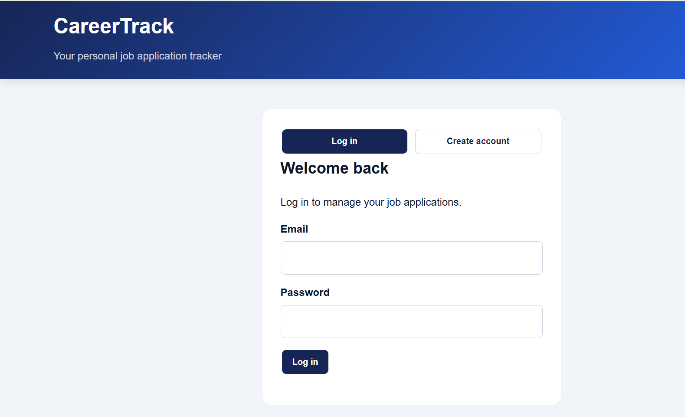
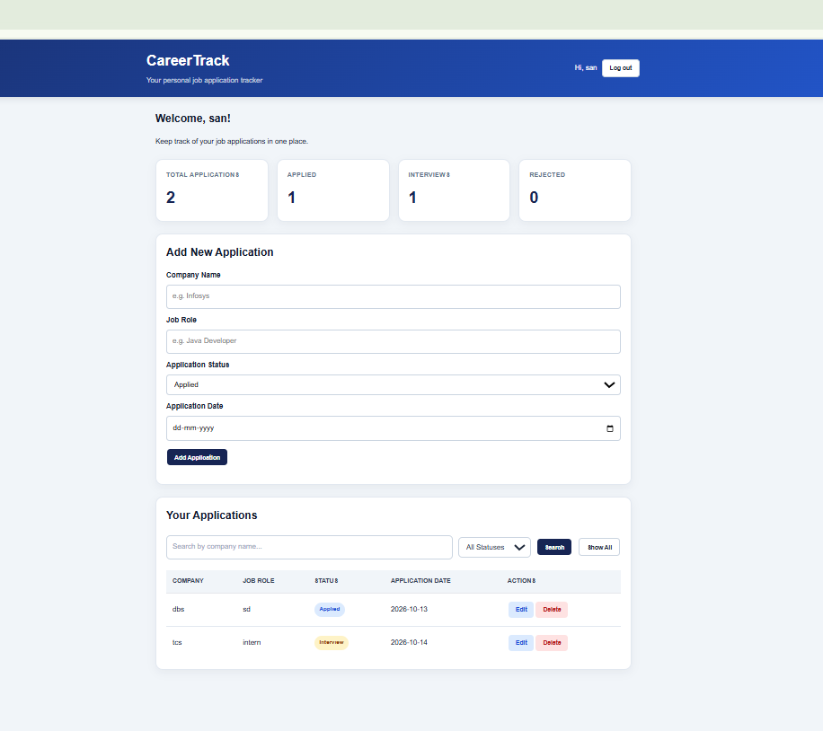

**# CareerTrack – Job Application Tracker**

**CareerTrack is a web application developed using Java and Spring Boot that helps users manage and track their job applications in one place.**

**## Features**

**- User registration and login**

**- Add, view, update, and delete job applications**

**- Search applications by company name**

**- Filter applications by status**

**- Dashboard statistics for application tracking**

**- Session-based authentication**

**- User-specific application data**

**- Input validation and error handling**

**## Technologies Used**

**- \*\*Backend:\*\* Java 8, Spring Boot**

**- \*\*Database:\*\* MySQL**

**- \*\*Persistence:\*\* Spring Data JPA, Hibernate**

**- \*\*Frontend:\*\* HTML, CSS, JavaScript**

**- \*\*Build Tool:\*\* Maven**

**- \*\*Security:\*\* BCrypt password hashing and HTTP sessions**

**## Application Statuses**

**- Applied**

**- Interview**

**- Rejected**

**## Getting Started**

**### Prerequisites**

**- Java 8**

**- MySQL Server**

**- Eclipse IDE or another Java IDE**

**- Maven**

**### Setup**

**1. Clone or download this repository.**

**2. Create a MySQL database named `careertrack\_db`.**

**3. Configure the database URL, username, and password in `application.properties`.**

**4. Run the Spring Boot application.**

**5. Open the application in your browser using the configured local server address.**

**\*\*Note:\*\* Keep database credentials private. Do not upload passwords or other sensitive information to GitHub.**

**## Learning Outcomes**

**This project demonstrates practical experience with REST APIs, database integration, CRUD operations, validation, session management, and user-specific data access.**

**## Future Enhancements**

**- Deploy the application online.**

**- Add email notifications for application updates.**

**- Improve dashboard analytics.**
## Screenshots

### Login Page

### Dashboard

## Live Demo

**Live Website:** https://careertrack-pnb3.onrender.com

Explore CareerTrack, a job application tracking web application built using Java, Spring Boot, MySQL, and Docker.

